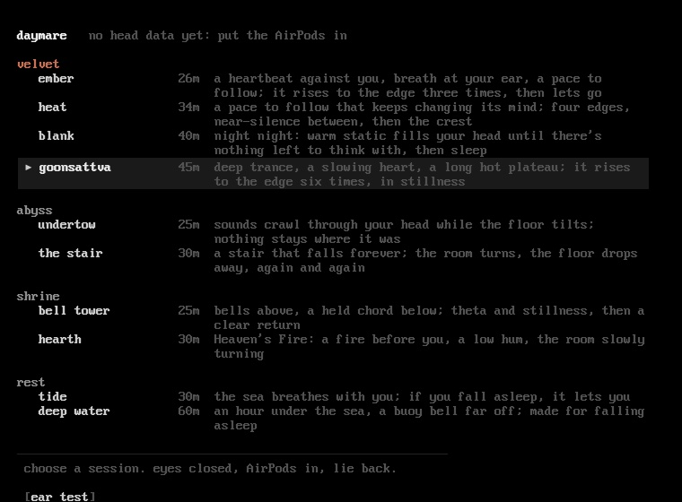
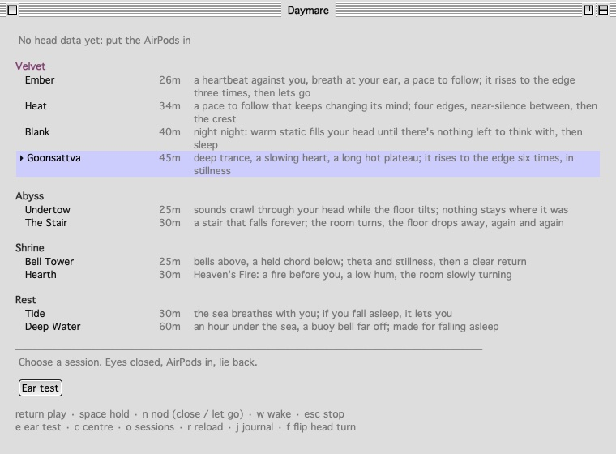
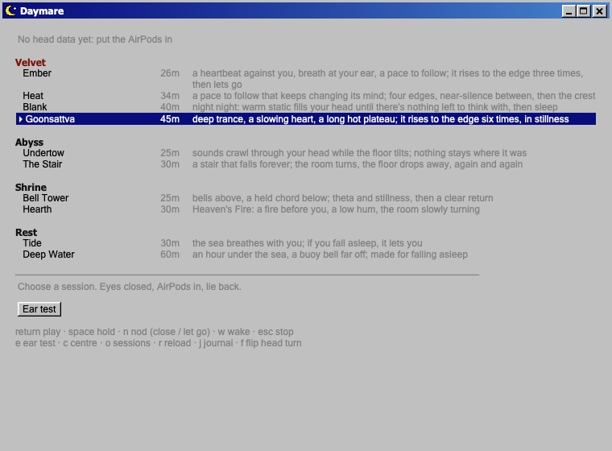
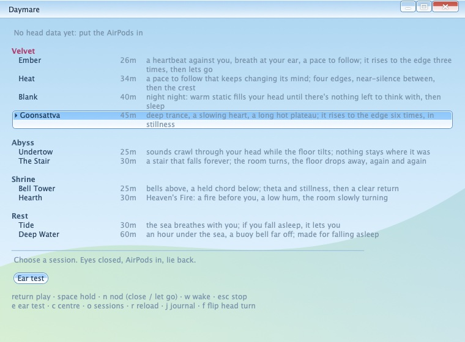
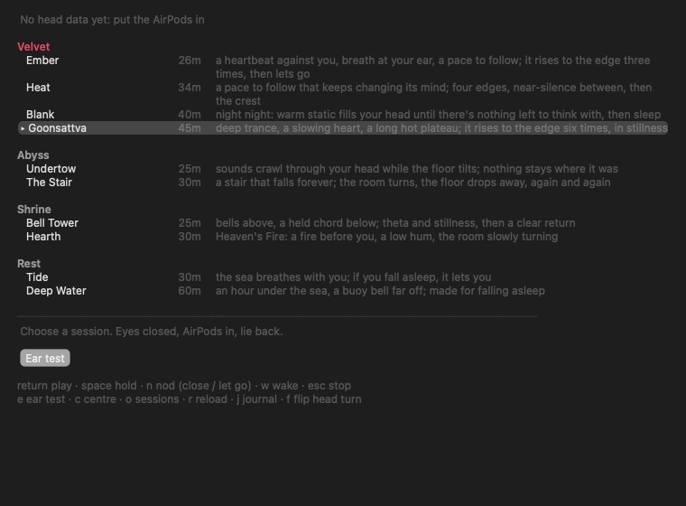

# Daymare

**Trance made only of sound, for the Mac and AirPods.** For adults.

Daymare plays trances built entirely from live-synthesized sound: no voice, no pictures, nothing recorded. Its heart is the **velvet** room: trances to put on while you watch, read, touch yourself or have sex. The sound builds, holds at the edge, pulls back into near-silence and builds again, and you lead it: a nod says you're close, another says let go. Around it are rooms for trance, illusion and sleep.

With AirPods that track your head, the sound-world stays put when you turn, a session waits while you stir, and you answer it without opening your eyes: a nod, a shake, a press of the stem.



## The rooms

- **velvet** (18+): trances for sex and solo play. *Ember* is a heartbeat and a breath at your ear that rise to the edge three times, *Heat* keeps changing its mind, *Goonsattva* is deep and slow with a long hot plateau, and *Blank* fills your head with warm static until you sleep.
- **abyss:** auditory illusions: a stair that falls forever, a floor that tilts, sounds crawling through your head.
- **shrine:** bells, fire and a slowly turning room, for trance and a clear return.
- **rest:** the sea, made for falling asleep. If you go still, it lets you.

## Answering it with your eyes closed

| | |
|---|---|
| Nod (down, up, down) | hold where you are, or go on. In velvet: "I'm close" while building, "let me go" at the edge, "again" afterwards |
| Shake | wake |
| AirPods stem | one press wakes, two presses are the nod |
| Keys | return play · space hold · n nod · w wake · esc stop · e ear test |

## Five looks

The first time Daymare opens, it asks you to confirm you're 18 or older and to pick a look. View ▸ Look changes it any time.

| | |
|---|---|
| **Tianmu.** OLED black and an old IBM pixel font: the darkest room to lie back in. |  |
| **Platinum.** Pinstripes, lavender and Geneva, like a Mac in 1998. |  |
| **Bevel.** Grey bevels and a navy title bar, like a PC in 1995. |  |
| **Glass.** Glossy sky-blue glass, from the Frutiger Aero years. |  |
| **Native.** Today's macOS: the system font, light or dark. |  |

## Write your own sessions

Every session is a plain text file in `~/Library/Application Support/Daymare/Sessions` (Library ▸ Open Sessions Folder): a few header lines, then keyframes such as `at 12:00 beat 4 breath 5.5`. Library ▸ Knob Reference lists every knob. Edit one and press **r** to reload; your changes are never overwritten.

## Install

**Requirements:** macOS 14 Sonoma or later, Apple silicon or Intel. Any headphones work; AirPods (3rd gen, Pro, Max or 4) add head tracking.

### From a release
1. Download `Daymare.zip` from the [Releases page](https://github.com/p-rudence/daymare/releases).
2. Unzip it and drag **Daymare** into Applications.
3. Daymare isn't notarized, so the first time, Control-click it and choose **Open**.
4. When it asks for **Motion & Fitness**, allow it: that's how it hears your head.

### From source
You need Xcode's command-line tools. There's no Xcode project; the build script calls `swiftc` directly.

```bash
git clone https://github.com/p-rudence/daymare.git
cd daymare
./build.sh           # builds build/Daymare.app (Apple silicon + Intel)
./build.sh install   # and copies it to /Applications
open build/Daymare.app   # launch it with open (macOS stops a bare binary that asks for motion)
./build.sh test      # the self-test: offline renders of every session, must say ALL PASSED
```

## Care

- Lie down, at a gentle volume. Never while driving or doing anything that needs your attention.
- There are no flashing lights, no voice and no suggestions, only sound, and the output is held under a limiter.
- If both test tones play in both ears, turn Spatial Audio off for Daymare in Control Center › Sound (Session ▸ Ear Test checks this).

## Privacy

Everything happens on your Mac. Daymare has no network access, no analytics and no account. Head motion is read live from your AirPods and only used in the moment. The journal (Library ▸ Journal) is a text file on your Mac with one line per session: when, which, how long, how still you were as a percentage, and how it ended. Delete it any time.

## Credits

- **Fonts.** The house look uses PxPlus IBM VGA 8x16 from [The Ultimate Oldschool PC Font Pack](https://int10h.org/oldschool-pc-fonts/) by VileR, bundled unmodified under [CC BY-SA 4.0](https://creativecommons.org/licenses/by-sa/4.0/) (see `Resources/Fonts`). The other looks use fonts that ship with macOS.
- **Everything else is Daymare's own:** every sound is synthesized in code, and the window chrome of each look and the icon are drawn for it.

## License

MIT, except the bundled VGA font, which keeps its CC BY-SA 4.0 licence. See [LICENSE](LICENSE).

Made by Tianmu Labs.
